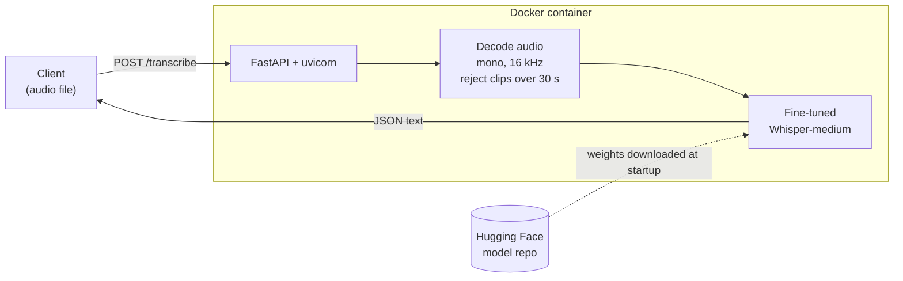

# Hassaniya ASR API

A speech-to-text web service for **Hassaniya Arabic**, the Arabic dialect spoken in Mauritania, for which almost no public speech tools exist. It wraps a fine-tuned [Whisper-medium](https://huggingface.co/openai/whisper-medium) model in a FastAPI app and ships as a Docker image, so it runs with one command on any machine that has Docker.

- Model weights: [HamidAmeer/hassaniya-whisper-medium](https://huggingface.co/HamidAmeer/hassaniya-whisper-medium)
- Docker image: [hamidameeradil/hassaniya-asr](https://hub.docker.com/r/hamidameeradil/hassaniya-asr)

## Results

Scored once on a held-out test set of 289 clips (14 minutes), with the checkpoint chosen on a separate validation set.

| Model | WER | CER |
|---|---|---|
| Whisper-medium, no fine-tuning | 85.5% | 46.7% |
| **Whisper-medium, fine-tuned (this service)** | **58.8%** | **22.5%** |

Fine-tuning cut the word error rate by about a third and more than halved the character error rate. WER overstates the errors: Hassaniya has no standard spelling, so many "mistakes" are spelling variants or word-boundary choices. CER is the fairer measure.

## How it works



- The model is loaded **once, at startup**, not on every request.
- Uploads are converted to 16 kHz mono (the format Whisper expects) and rejected if longer than 30 s, Whisper's input limit.
- Decoding uses the same settings as the evaluation above, including guards that stop the model from looping on a repeated phrase.
- The weights (about 3 GB) are **not** inside the image. The container downloads them from Hugging Face on first start, which keeps the image small.

## Run it

You need [Docker](https://www.docker.com/products/docker-desktop/). The first start downloads about 3 GB of weights, so give it a few minutes.

```bash
docker run --rm -p 8000:8000 hamidameeradil/hassaniya-asr:latest
```

Then open **http://127.0.0.1:8000/docs** for the interactive page, or call it directly:

```bash
curl -X POST -F "file=@clip.wav" http://127.0.0.1:8000/transcribe
```

Response:

```json
{"transcription": "...", "duration_seconds": 1.96}
```

`GET /health` returns `{"status": "ok", "device": "cpu"}`.

**Use weights from a local folder instead** (no download):

```bash
docker run --rm -p 8000:8000 -v "<folder with the model files>:/model" -e CHECKPOINT_PATH=/model hamidameeradil/hassaniya-asr:latest
```

**Run without Docker:**

```bash
python -m venv venv && venv\Scripts\activate     # Windows
pip install -r requirements.txt
uvicorn main:app
```

## Endpoints

| Method | Path | Description |
|---|---|---|
| POST | `/transcribe` | Upload an audio file (wav, flac or ogg, up to 30 s). Returns the text and the clip length. |
| GET | `/health` | Liveness check; shows whether the model runs on `cpu` or `cuda`. |

Errors: `400` if the file cannot be read as audio, `413` if it is longer than 30 s.

## Project files

| File | Purpose |
|---|---|
| `main.py` | The FastAPI app: audio preparation, model loading, endpoints. |
| `Dockerfile` | Builds the image: Python 3.13, CPU-only PyTorch, pinned dependencies. |
| `requirements.txt` | Pinned Python dependencies. |

## Limitations

- **Slow on CPU.** The image uses CPU-only PyTorch so it runs anywhere; Whisper-medium is much faster on a GPU.
- **Short clips only.** Anything over 30 s is rejected rather than split into chunks.
- **Accuracy is limited by data.** The model was fine-tuned on about 3 hours of speech; more and more consistently transcribed data is the main way to improve it.
- No authentication or rate limiting, so it is meant for local use and demos, not for exposing publicly as-is.
